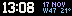

# SuperBar



A configurable dashboard that runs on BUSY Bar. No account or subscription is required; no computer needs to stay on.

## What works

- **Clock:** 12/24-hour time, optional date and ISO week number, three date formats. Turning off date, week, and weather centers the clock. In 12-hour mode, AM/PM appears on the front only in that centered layout; the back display always shows it.
- **Weather:** configurable location, Celsius/Fahrenheit, upcoming sunset, and weather alerts enabled by default using Open-Meteo. Alerts show a full-screen message for 30 seconds by default, then a small drop (rain) or bolt (thunderstorms). The clock continues when weather is unavailable. Weather older than 30 minutes is marked stale and cannot trigger alerts.
- **Quick timer:** turn the wheel to adjust 1–180 minutes, start, pause/resume, cancel, and completion alerts.
- **World clocks:** up to five cities, using the Bar’s own time-zone database (refreshed every half hour). That database is older than current rules in places: firmware 1.3.1 still applies DST to Brazil, for example.
- **Pinned reminder:** a short reminder replaces the date column beside the clock until dismissed. Two short lines fit (about six capitals each); longer text ends in an ellipsis. Its own view shows one line, and the back display scrolls the full text.
- **Date countdown:** days until a trip, launch, or other date, using the Bar's local calendar day.
- **Attention settings:** automatic alerts, a manual-browsing grace period, quiet hours, and front-display dimming. Each module can be disabled.

**Calendar uses Busy’s existing integration.** Keep Google Calendar connected through [Busy Cloud](https://cloud.busy.app). Its own reminders and meeting status take precedence over SuperBar. This project does not register a Google app, request OAuth access, read calendar events, connect iCloud, or calculate free time. Configure meeting titles, reminder lead times, and calendar sounds in Busy. SuperBar’s quiet hours do not change Busy’s calendar settings.

## Try it on your computer

Requires Node 22+ and npm. Development was verified with Node 26.

```sh
cd ~/dev/superbar
npm ci
npm start
```

Open **http://localhost:4381**. This is a simulator and settings editor, not the hardware display. It serves only to this computer. Its front screen uses the same pixel renderer, fonts, and state machine as the device. The back-screen preview draws the same native text elements with the same firmware fonts; long notes that scroll on the device are shown clipped. Preview scenarios use synthetic data and never send alerts to the Bar.

With the Bar connected over USB, the page starts from SuperBar’s settings on the Bar, and **Send to Bar** writes changes back; install the current build first. Without a Bar, it previews the defaults. You can also edit every setting in the Bar’s own web page: open `http://10.0.4.20` and choose **Apps → SuperBar**. The running app picks up changes within a minute.

## Install on BUSY Bar

Target: firmware **1.3.1+**, with HTTP API **27.14.0+**. The manifest declares the API floor; the Bar’s installer checks compatibility. Connect over USB and check its actual version at `http://10.0.4.20/api/version`.

```sh
npm run build
npm run app:install   # stages, installs, and launches
npm run app:run       # launches an installed copy
```

These use `scripts/install.mjs`, not `busy-cli app`: on Node 26, busy-cli’s HTTP client rejects every response from firmware 1.3.1.

Or open `http://10.0.4.20`, choose **Apps → Add app**, and upload:

```text
dist/me.molodtsov.superbar.tgz
```

Switch the Bar to **APPS → SuperBar → START**. The app runs on the device after installation; no running computer is needed for clock, weather, timers, native calendar overlays, reminders, and countdowns. Weather needs Wi-Fi. Time and local UTC offset come from the device's clock.

To install or use the setup page over Wi-Fi instead of USB, copy `.env.example` to `.env` and set `BUSY_BAR_URL` to the Bar’s address. For installing with HTTP API password protection, also set `BUSY_BAR_TOKEN`; the setup page works over Wi-Fi only without a password. Keep `.env` private.

## Controls

- **Wheel:** browse clock, timer, weather, saved cities, reminder, and countdown. Disabled views are omitted.
- **Start:** enter timer setup; turn the wheel to adjust duration, then press Start or OK to begin. During a timer, Start pauses/resumes it.
- **OK:** return to the automatic view, or dismiss a temporary alert. On the timer view it also starts/pauses/resumes.
- **Hold OK:** cancel the timer when viewing it, or dismiss the pinned reminder when viewing it.
- **Back:** dismiss an alert or return to the clock. Back again on the clock quits SuperBar.
- **Hold Back:** firmware-controlled force quit.

After the configured grace period, a manually selected view returns to the clock or running timer. An expired timer takes priority over manual browsing. Weather alerts wait while you browse and never interrupt during quiet hours. After the message expires or is dismissed, a small weather icon remains on ordinary views until the forecast clears, expires, or becomes stale. Icons do not cover the clock, date, reminder, or timer progress bar. SuperBar makes no audio requests. An alert's display window starts when it is observed: if you stay in a manual view beyond it, the alert is silently skipped. Reminders stay pinned; ordinary notifications expire.

On firmware with `localStorage`, timer state and dismissal choices are saved on button actions, not every tick. On firmware without it, they last only for the current app session. A paused timer is canceled with Hold OK from its timer view.

## World cities

World cities use `LABEL=Area/City`, separated by semicolons, for example:

```text
NYC=America/New_York;LONDON=Europe/London;TOKYO=Asia/Tokyo
```

The city part must match one of the 115 cities in the Bar’s list (`http://10.0.4.20/api/time/tzlist`), such as `New_York`, `Sao_Paulo`, or `Delhi`. Common cities with identical rules are mapped automatically: Lisbon and Dublin use London; Paris and most of central Europe use Berlin; Toronto uses New York; Kolkata and Mumbai use Delhi; Singapore uses Kuala Lumpur. See `shared/zones.js`. A city that matches nothing shows UNKNOWN ZONE.

## Development and verification

```sh
npm run build
npm test
npm run check
npm run format:check
```

Tests cover ISO weeks, time zones and DST boundaries, timer interactions, alert priority and expiry, quiet hours, stale data, frame dimensions, persistence, and the actual device bundle in a constrained JavaScript harness. Build before tests, because runtime tests execute the packaged `main.js`.

- `src/main.js`: device API adapter, polling, lifecycle, optional persistence.
- `shared/`: settings, deterministic behavior, weather parser, 72×16 pixel renderer.
- `shared/fonts.js`: generated by `scripts/extract-fonts.py` from the firmware 1.3.1 TTFs (`assets/shared/fonts/ttf`). Do not edit by hand.
- `web/`, `scripts/dev.mjs`: browser simulator and settings page.
- `scripts/install.mjs`, `scripts/bar.mjs`: install over USB or Wi-Fi.
- `scripts/settings.mjs`: generates the native settings schema. Do not edit the generated JSON directly.
- `test/`: logic and packaged-runtime tests.

Tested on a BUSY Bar with firmware 1.3.1 over USB: install, launch, front and back rendering, weather, the timer, Start, Back, and the wheel. Still untested: long presses, calendar overlays, and Wi-Fi loss. The updated weather message/icon transition still needs a hardware check. See `docs/verification.md`.

## API references

- [JS apps](https://busy.marketing/docs/bar/dev/js-apps)
- [Runtime reference](https://developer.busy.app/javascript-applications.html)
- [Official tooling](https://github.com/busy-app/busy-tools)
- [Settings API](https://github.com/busy-app/busybar-firmware/blob/dev/applications/services/web_server/openapi/apps.yaml)
- [Calendar integration](https://docs.busy.app/bar/apps-and-integrations/google-calendar)
- [Weather API](https://open-meteo.com/en/docs)

Research notes and the calendar decision are in [docs/architecture.md](docs/architecture.md).

## License

MIT for application code and original artwork. See [third-party notices](THIRD_PARTY_NOTICES.md) for bundled assets and their licenses.

## Weather data and privacy

Weather data is provided by [Open-Meteo](https://open-meteo.com/). With weather enabled, the configured coordinates are sent to its API. See [Privacy](PRIVACY.md).

Catalog builds use plain `busy-cli build`. Generated assets are committed; run `npm run generate` and commit its output when changing their sources.
